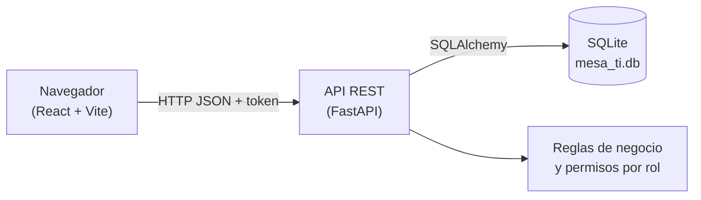
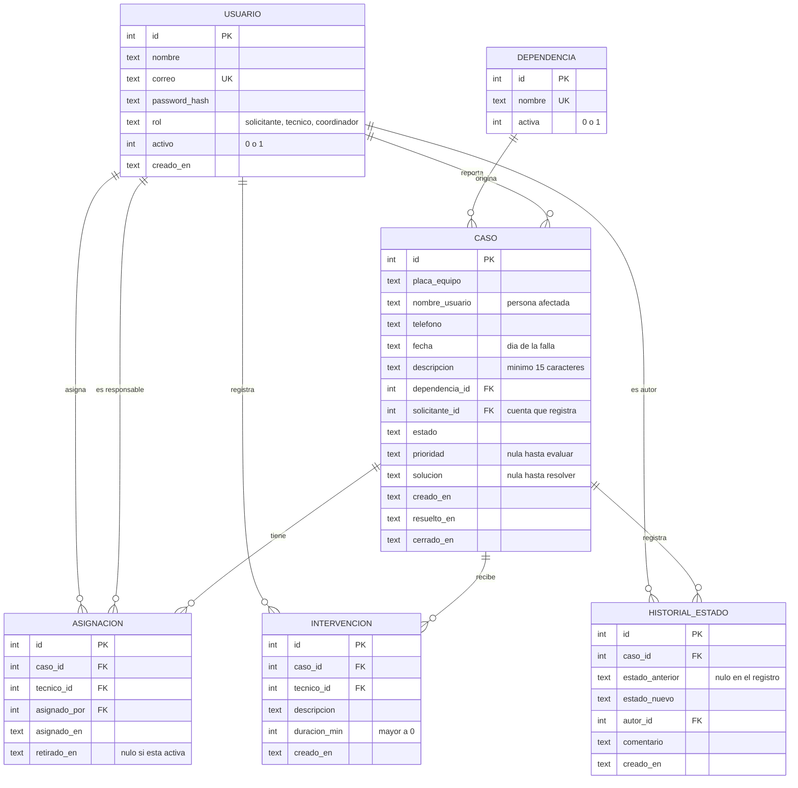
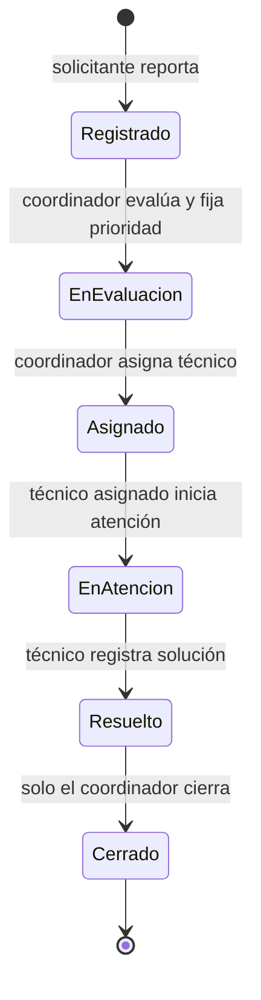

# Diseño – Mesa de Servicios TI

> **Estado:** borrador para revisión del equipo (Actividad 3). Parte de `docs/requisitos.md`.
> El esquema SQL ejecutable y su código de acceso se entregan en la Actividad 4 (implementación); este documento define su diseño.

## 1. Decisiones técnicas

| Componente | Elección | Justificación |
|---|---|---|
| Backend / API | Python + FastAPI | Documentación OpenAPI/Swagger automática en `/docs` (RNF-05) y validación con Pydantic (RNF-01). |
| Base de datos | SQLite (archivo local) | Ejecución en vivo sin servidor aparte; cada integrante usa su archivo `.db` (fuera de Git) y un *seeder*. Soporta claves foráneas, `CHECK`, triggers e índices parciales. |
| Acceso a datos | SQLAlchemy | Cambiar de motor solo exige cambiar la cadena de conexión. |
| Frontend | React + Vite | Consume la API REST por HTTP. |
| Autenticación | Token JWT + contraseñas con hash | RF-01 y RNF-02. Aprobado por el equipo. |

Limitación declarada: SQLite no está pensado para muchas escrituras simultáneas; es suficiente para la demostración.

## 2. Arquitectura



Responsabilidades:
- **Frontend:** pantallas por rol, formularios y línea de tiempo. No decide permisos; solo los refleja.
- **Backend:** única fuente de verdad de la lógica: valida entradas, aplica los permisos por rol y controla las transiciones de estado y sus precondiciones (RN-01, RN-03), aunque la solicitud no venga de la interfaz. Se verifica con pruebas.
- **Base de datos:** protege la integridad de los datos con restricciones, índices y unos pocos triggers de protección, aunque el backend tenga un error (ver sección 3.4).

## 3. Modelo de datos

### 3.1 Diagrama entidad-relación



### 3.2 Decisiones de modelado

| Decisión | Alternativa descartada | Por qué |
|---|---|---|
| `asignacion` como tabla de historial; el responsable es la fila activa (`retirado_en` nulo) | Columna `tecnico_id` en `caso` | Guarda quién fue responsable y cuándo (RN-10) sin duplicar datos, y evita que `caso.tecnico_id` y el historial se contradigan. |
| `historial_estado` separado de `asignacion` e `intervencion` | Una sola tabla de eventos con columnas opcionales | Cada tabla tiene sus columnas obligatorias (`duracion_min`, `tecnico_id`…) sin nulos "por tipo". La línea de tiempo se arma con la vista `v_linea_tiempo`, sin escribir el mismo hecho dos veces. |
| `dependencia` como catálogo | Texto libre | Evita variantes de escritura y permite agrupar en el tablero. |
| `nombre_usuario` y `solicitante_id` separados | Solo la cuenta | Un caso puede reportarlo alguien por otra persona. |
| `fecha` (día de la falla) y `creado_en` (momento del registro) separados | Un solo campo | Son dos hechos distintos: cuándo falló y cuándo se reportó. |
| Usuarios con `activo` en vez de borrado | `DELETE` | Los casos conservan quién los atendió; la clave foránea con `ON DELETE RESTRICT` impide borrar. |
| Fechas en UTC como texto ISO-8601 | Zona local | Ordenan bien alfabéticamente y no dependen del equipo. |

Con esto el modelo cumple la tercera forma normal: cada dato depende solo de la clave de su tabla y no hay datos derivados guardados (el responsable y la línea de tiempo se calculan).

### 3.3 Índices

| Índice | Consulta que acelera |
|---|---|
| `ix_caso_solicitante (solicitante_id, creado_en)` | "Mis casos" del solicitante (RF-03) |
| `ix_caso_estado (estado, creado_en)` | Casos abiertos y cerrados del tablero (RF-10) |
| `ix_caso_placa (placa_equipo)` | Casos anteriores de un mismo equipo |
| `ix_caso_dependencia (dependencia_id)` | Conteos por dependencia |
| `ux_asignacion_activa (caso_id) WHERE retirado_en IS NULL` | **Único**: un solo responsable activo por caso (RN-02) |
| `ix_asignacion_tecnico_activa (tecnico_id) WHERE retirado_en IS NULL` | Lista de casos del técnico (RF-06) |
| `ix_intervencion_caso (caso_id, creado_en)` | Línea de tiempo (RF-09) |
| `ix_historial_caso (caso_id, creado_en)` | Línea de tiempo (RF-09) |

### 3.4 Reglas protegidas por la base de datos

Para no repetir la lógica en dos sitios, la base de datos solo protege la integridad con restricciones, índices y unos pocos triggers de protección (caso cerrado inmutable e historial sin edición). El flujo de estados y sus precondiciones viven en el backend.

| Regla | Mecanismo en la base de datos |
|---|---|
| RN-02 Responsable único | Índice único parcial `ux_asignacion_activa` |
| RN-04 Caso cerrado inmutable | Trigger `trg_caso_cerrado_inmutable`; los casos no se borran |
| RN-05 Historial *append-only* | Triggers que bloquean `UPDATE` y `DELETE` en `intervencion` y `historial_estado`; la asignación solo puede retirarse una vez y no se borra |
| RN-08 Datos del reporte | `NOT NULL` y `CHECK` (descripción de 15 caracteres o más, fecha válida) |
| RN-09 Prioridad en la evaluación | `CHECK`: toda fila fuera de `Registrado` tiene prioridad |
| Coherencia estado y datos | `CHECK`: `Resuelto` y `Cerrado` exigen solución y fechas; `Cerrado` exige `cerrado_en` |
| Integridad referencial | Claves foráneas con `ON DELETE RESTRICT` |

Quedan en el **backend**, con pruebas: RN-01 (transiciones válidas), RN-02 (solo el responsable interviene), RN-03 (resolver con intervención y solución), RN-06 y RN-07 (permisos por rol), RN-10 (registrar quién asigna y cuándo), que la fecha del reporte no sea futura y que los datos del reporte no se editen.

### 3.5 Vistas

- `v_caso_detalle`: caso con dependencia, solicitante y responsable activo (CA-03).
- `v_linea_tiempo`: unión de cambios de estado, asignaciones/reasignaciones e intervenciones (CA-04). Se consulta con `ORDER BY momento, orden, ref_id`.

### 3.6 Datos iniciales (*seeder*)

Un usuario por rol como mínimo (más un segundo técnico para probar la reasignación), un catálogo de dependencias de ejemplo y algunos casos en distintos estados. Todo con datos ficticios.

### 3.7 Verificación

El diseño del esquema se validó en SQLite 3.49 con 45 operaciones: un flujo completo válido (registro, evaluación, asignación, reasignación, intervenciones, resolución y cierre) y los rechazos esperados (datos inválidos, segundo responsable, edición o borrado del historial, modificación de un caso cerrado). Resultado: 45 correctas, 0 fallidas. El script SQL y el de prueba se incluirán en el repositorio con la Actividad 4.

### 3.8 Integración con Python (ORM)

Diseño previsto, que se implementa en la Actividad 4:

- **Creación de la base:** un script `schema.sql` (tablas, índices, triggers, vistas). No se usa `create_all()` del ORM, porque no crearía triggers ni vistas.
- **Acceso a datos:** modelos SQLAlchemy, una clase por tabla y dos vistas de solo lectura. Los estados, roles y prioridades son enumeraciones, y las fechas se leen como `datetime` en UTC.
- **Conexión:** se activa `PRAGMA foreign_keys = ON` en cada conexión y se ofrece una sesión por solicitud a FastAPI. La ruta de la base se toma de `DATABASE_URL` o, si falta, de un archivo local.
- **Pruebas previstas:** que los modelos coincidan con el esquema real (columnas, nulabilidad, claves primarias y foráneas), el flujo completo con el ORM y las protecciones de la base.

## 4. Máquina de estados



- No hay estado `Cancelado` ni reapertura.
- Reasignación: solo el coordinador, mientras el caso esté en `Asignado` o `En atención`; el estado no cambia.
- La evaluación (prioridad) la hace el coordinador, porque el técnico solo ve casos ya asignados.
- `Resuelto` exige al menos una intervención y el texto de solución (RN-03).

## 5. Permisos por rol

| Acción | Solicitante | Técnico | Coordinador |
|---|:-:|:-:|:-:|
| Reportar caso | Sí | No | No |
| Ver casos | Solo los suyos | Solo los asignados | Todos |
| Evaluar y fijar prioridad | No | No | Sí |
| Asignar / reasignar técnico | No | No | Sí |
| Iniciar atención, registrar intervención, resolver | No | Solo en su caso asignado | No |
| Cerrar | No | No | Sí |
| Ver línea de tiempo | Sus casos | Sus casos asignados | Todos |
| Resumen consolidado | No | No | Sí |

## 6. API REST

| Método | Ruta | Descripción | Rol | Requisito |
|---|---|---|---|---|
| GET | `/salud` | Estado del servicio | público | – |
| POST | `/auth/login` | Devuelve token con el rol | público | RF-01 |
| GET | `/auth/me` | Usuario autenticado | todos | RF-01 |
| GET | `/dependencias` | Catálogo para el formulario | todos | RF-02 |
| POST | `/casos` | Registrar caso | solicitante | RF-02, CA-01 |
| GET | `/casos` | Listar casos según rol (filtro `estado`) | todos | RF-03, CA-03 |
| GET | `/casos/{id}` | Detalle con responsable y estado | todos* | RF-03, CA-03, CA-05 |
| PATCH | `/casos/{id}/evaluacion` | Fijar prioridad; pasa a `En evaluación` | coordinador | RF-04, CA-02 |
| PUT | `/casos/{id}/tecnico` | Asignar o reasignar técnico | coordinador | RF-05, CA-02 |
| POST | `/casos/{id}/iniciar-atencion` | Pasa a `En atención` | técnico asignado | RF-07, CA-02 |
| POST | `/casos/{id}/intervenciones` | Registrar intervención | técnico asignado | RF-06, CA-04 |
| POST | `/casos/{id}/resolver` | Registrar solución; pasa a `Resuelto` | técnico asignado | RF-08, CA-05 |
| POST | `/casos/{id}/cerrar` | Cerrar caso | coordinador | RF-08, CA-05 |
| GET | `/casos/{id}/historial` | Línea de tiempo del caso | todos* | RF-09, CA-04 |
| GET | `/tecnicos` | Técnicos activos | coordinador | RF-05 |
| GET | `/coordinacion/resumen` | Casos abiertos, cerrados, fechas y desglose por técnico | coordinador | RF-10, CA-06 |

\* Solo si el caso le corresponde al usuario (RN-06).

Códigos de error (RNF-04): `400` transición de estado inválida, `401` sin token o token inválido, `403` rol o caso no autorizado, `404` caso inexistente, `422` datos inválidos. Sin trazas internas en las respuestas.

Ejemplo de registro:

```json
POST /casos
{
  "placa_equipo": "ABC-123",
  "nombre_usuario": "Ana Pérez",
  "telefono": "3001234567",
  "fecha": "2026-11-15",
  "descripcion": "El computador no enciende desde la mañana",
  "dependencia_id": 1
}
```

Respuesta `201`: caso con `estado: "Registrado"`, `prioridad: null`, `tecnico: null`.

## 7. Prototipos de interfaz (descripción)

- **Inicio de sesión:** correo y contraseña.
- **Solicitante:** formulario de reporte (placa, nombre del usuario, teléfono, fecha, dependencia y descripción), lista "Mis casos" con estado y responsable, detalle con resultado y línea de tiempo.
- **Técnico:** lista de casos asignados, detalle con formulario de intervención y botones "Iniciar atención" y "Resolver".
- **Coordinador:** tablero (abiertos, cerrados, fechas, por técnico), lista de todos los casos, detalle con prioridad, selector de técnico y botón "Cerrar".

Los prototipos gráficos se agregarán en `evidencias/` o aquí antes de la sustentación.

## 8. Correspondencia con las condiciones de aceptación

| CA | Endpoints | Tablas |
|---|---|---|
| CA-01 | `POST /casos` | `caso`, `historial_estado` |
| CA-02 | `PATCH /casos/{id}/evaluacion`, `PUT /casos/{id}/tecnico`, `POST .../iniciar-atencion` | `caso`, `asignacion`, `historial_estado` |
| CA-03 | `GET /casos`, `GET /casos/{id}` | `v_caso_detalle` |
| CA-04 | `POST .../intervenciones`, `GET .../historial` | `intervencion`, `v_linea_tiempo` |
| CA-05 | `POST .../resolver`, `POST .../cerrar`, `GET /casos/{id}` | `caso`, `historial_estado` |
| CA-06 | `GET /coordinacion/resumen` | `caso`, `asignacion`, `usuario` |
