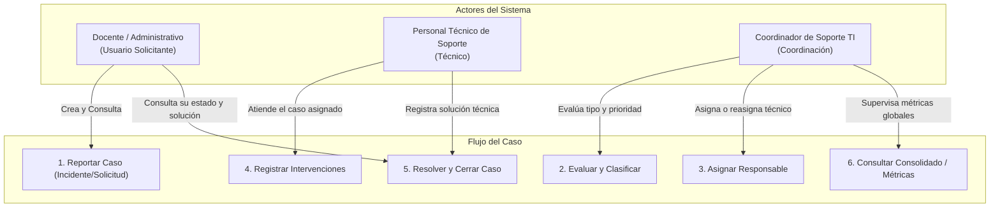

# Especificación de Requisitos y Guía de Entrevista con el Docente
**Proyecto:** Mesa de Servicios de Soporte Tecnológico (Mesa TI)  
**Asignatura:** Aplicaciones y Servicios Web — Guía PF-02  
**Equipo de Desarrollo:** Juan David Arias Ospina & Simón Herrera  
**Rol del Docente:** Representante de la Organización / Cliente  
**Versión:** 1.0 (Consolidado con correcciones y trazabilidad)  
**Fecha:** Noviembre 2026  

---

## 1. Ficha del Proyecto y Participantes

| Campo | Detalle |
|---|---|
| **Código del Proyecto** | PF-02 — Mesa de servicios de soporte tecnológico |
| **Estudiantes Desarrolladores** | Juan David Arias Ospina & Simón Herrera |
| **Docente / Cliente Evaluador** | Juan Carlos Morales Guerra |
| **Objetivo de la Sesión** | Delimitación del alcance, validación de reglas de negocio y aprobación formal de requisitos (Actividad 2). |

---

## 2. Actores y Matriz de Permisos

El sistema define tres roles con responsabilidades y fronteras de acceso claramente delimitadas:

| Actor | Responsabilidad Principal | Acceso a Datos y Operaciones Permitidas |
|---|---|---|
| **Solicitante** (`solicitante`) | Reportar necesidades tecnológicas y consultar el estado y resultado de sus propios requerimientos. | - Crear incidentes o solicitudes. - Consultar **únicamente sus propios casos** y ver el resultado final. |
| **Técnico** (`tecnico`) | Diagnosticar, atender e intervenir en los casos que le han sido asignados. | - Consultar la lista de casos asignados a su persona. - Registrar bitácora de intervenciones cronológicas. - Cambiar estado a `En atención` y luego a `Resuelto` con detalle de solución. - No puede reasignarse casos ni ver métricas globales. |
| **Coordinador** (`coordinador`) | Supervisar la mesa, clasificar casos, asignar cargas y monitorear el desempeño global. | - Acceso total de consulta a todos los casos. - Evaluar prioridad y asignar/reasignar el técnico responsable. - Cierre definitivo de casos (los casos cerrados no se reabren). - Consultar tablero consolidado (CA-06). |

---

## 3. Catálogo de Requisitos Funcionales (RF) con Criterios de Aceptación Verificables

Cada requisito responde directamente a las **Condiciones de Aceptación Obligatorias (CA-01 a CA-06)** de la guía docente.

| ID | Requisito Funcional | CA Obligatoria | Criterios de Aceptación Verificables (Condición de Éxito y Validación) |
|---|---|---|---|
| **RF-01** | **Autenticación y Control de Acceso (RBAC)** | Todas | **Éxito:** Usuario autenticado recibe credencial de sesión con su rol (`solicitante`, `tecnico`, `coordinador`). **Validación:** Operaciones sobre rutas protegidas sin token o con rol no autorizado devuelven `401 Unauthorized` o `403 Forbidden`. |
| **RF-02** | **Registro de Caso (Incidente / Solicitud)** | **CA-01** | **Éxito:** Solicitante envía formulario con placa del equipo, nombre del usuario, teléfono, fecha, descripción (mínimo 15 caracteres) y dependencia. Incidentes y solicitudes comparten el mismo flujo. El sistema persiste el caso con estado inicial `Registrado`, marca de tiempo y autor. **Validación:** Campos vacíos o descripción corta devuelven error `422 Unprocessable Entity` sin registrar datos. |
| **RF-03** | **Consulta y Seguimiento por el Solicitante** | **CA-03, CA-05** | **Éxito:** El solicitante ve la lista de casos creados por él, mostrando ID, título, estado actual, técnico responsable (si aplica) y fecha. **Validación:** Intentar consultar el detalle de un caso perteneciente a otro usuario devuelve `403 Forbidden`. |
| **RF-04** | **Evaluación y Clasificación del Caso** | **CA-02** | **Éxito:** Coordinador o técnico autorizado revisa el caso, fija la prioridad como etiqueta (`Baja`, `Media`, `Alta`, `Crítica`; sin SLA) y pasa el estado a `En evaluación`. |
| **RF-05** | **Asignación y Reasignación de Responsable** | **CA-02, CA-03** | **Éxito:** El coordinador selecciona un técnico activo y lo asigna al caso. El estado pasa a `Asignado` y se asocia el `id_tecnico`. **Validación:** Si se reasigna, el evento de reasignación queda guardado en la auditoría del caso. |
| **RF-06** | **Registro de Intervenciones Técnicas** | **CA-04** | **Éxito:** El técnico asignado registra una actuación detallando trabajo realizado y tiempo/fecha. Queda vinculada al caso con el autor. **Validación:** Un técnico que NO es el responsable asignado no puede agregar intervenciones (`403 Forbidden`). |
| **RF-07** | **Control de Transiciones de Estado** | **CA-02, CA-03** | **Éxito:** El estado del caso solo puede avanzar mediante las transiciones válidas de la máquina de estados. **Validación:** Saltos de estado no permitidos (ej. de `Registrado` directo a `Cerrado`) son rechazados con código `400 Bad Request`. |
| **RF-08** | **Resolución y Cierre del Caso** | **CA-05** | **Éxito:** El técnico registra el diagnóstico y solución final, pasando el caso a `Resuelto`. Solo el coordinador pasa el caso a `Cerrado`; un caso cerrado no se reabre. **Validación:** No se puede resolver sin registrar al menos una intervención previa y el texto de solución. |
| **RF-09** | **Consulta del Historial Cronológico** | **CA-04** | **Éxito:** Cualquier actor autorizado que consulte el caso puede ver todo el proceso como línea de tiempo en el detalle del caso (fecha, autor, descripción). No hay notas privadas. |
| **RF-10** | **Tablero Consolidado de Coordinación** | **CA-06** | **Éxito:** El coordinador consulta un endpoint de resumen que retorna: casos abiertos y casos cerrados, con sus fechas; se conserva el desglose por técnico asignado por exigencia de CA-06. |

---

## 4. Reglas de Negocio Oficiales (RN)

- **RN-01 — Máquina de Estados y Transiciones Permitidas:**
  El ciclo de vida obligatorio del caso es:
  $$\text{Registrado} \longrightarrow \text{En evaluación} \longrightarrow \text{Asignado} \longrightarrow \text{En atención} \longrightarrow \text{Resuelto} \longrightarrow \text{Cerrado}$$
  - *Sin cancelación:* no existe el estado `Cancelado`; el solicitante no puede cancelar casos (decisión del equipo).
  - *Transición a Resuelto:* Exclusiva del técnico asignado al ingresar la solución.
  - *Transición a Cerrado:* Exclusiva del coordinador. Un caso cerrado no se puede reabrir.
- **RN-02 — Responsable Único Activo:** Un caso solo puede tener **un técnico responsable asignado** a la vez. Solo el responsable actual puede registrar intervenciones y marcar el caso como resuelto.
- **RN-03 — Condición Previa para Solución:** No se permite cambiar el estado a `Resuelto` o `Cerrado` si el caso no cuenta con **al menos una intervención registrada** y un texto explicativo del resultado/solución.
- **RN-04 — Inmutabilidad de Casos Cerrados:** Un caso en estado `Cerrado` queda bloqueado contra nuevas intervenciones, reasignaciones o modificaciones de estado.
- **RN-05 — Inviolabilidad del Historial (Append-only):** Las intervenciones técnicas **no pueden ser editadas ni eliminadas** bajo ninguna circunstancia, garantizando trazabilidad legal y auditoría estricta.
- **RN-06 — Aislamiento y Privacidad:** El solicitante solo puede listar y consultar el detalle de los casos creados por su propio usuario.
- **RN-07 — Control Exclusivo de Coordinación:** Únicamente el usuario con rol `coordinador` puede asignar/reasignar técnicos y consultar el endpoint consolidado (`CA-06`).
- **RN-08 — Integridad de Datos en Registro:** Es obligatorio indicar placa del equipo, nombre del usuario, teléfono, fecha, dependencia y una descripción con longitud mínima de 15 caracteres para registrar un caso.
- **RN-09 — Jerarquía de Prioridad:** El solicitante no indica prioridad al reportar; la prioridad se asigna como etiqueta durante la fase de evaluación.
- **RN-10 — Registro de Auditoría de Asignación:** Cada vez que un caso cambia de técnico responsable, se genera automáticamente una entrada en el historial con fecha, coordinador que reasignó y técnico anterior/nuevo.

---

## 5. Requisitos No Funcionales (RNF)

- **RNF-01 — Validación Robusta en Servidor:** Validación de esquemas en backend con Pydantic en FastAPI, garantizando tipos de datos, longitudes y valores permitidos.
- **RNF-02 — Seguridad y Cero Secretos:** Contraseñas almacenadas con algoritmo de hashing seguro. Exclusión de credenciales y variables de entorno mediante `.gitignore` y provisión de `.env.example`.
- **RNF-03 — Persistencia Relacional:** Base de datos relacional (PostgreSQL / SQLite según entorno) con claves foráneas, restricciones de integridad referencial e índices.
- **RNF-04 — Tratamiento Seguro de Excepciones:** Respuestas HTTP normalizadas ante fallos (400, 401, 403, 404, 422, 500) sin exponer *stack traces* internos de la base de datos al cliente.
- **RNF-05 — Documentación de Servicios:** API REST autodocumentada mediante OpenAPI y Swagger UI accesible en `/docs`.
- **RNF-06 — Usabilidad e Interfaz:** Frontend web desarrollado en framework moderno, responsivo para navegadores de escritorio.
- **RNF-07 — Reproducibilidad:** Instrucciones claras en `README.md` que permitan a cualquier evaluador instalar dependencias, configurar el entorno y levantar la aplicación.

---

## 6. Supuestos Estratégicos del Proyecto (S)

- **S-01 — Categorías del Servicio:** Hardware, Software, Conectividad/Redes, Cuentas/Accesos.
- **S-02 — Niveles de Prioridad:** Baja, Media, Alta, Crítica.
- **S-03 — Asignación Manual:** La asignación de casos se realiza manualmente por el coordinador (no requiere algoritmos automáticos de balanceo).
- **S-04 — Ámbito de Comunicación:** Toda la interacción y seguimiento se realiza dentro de la aplicación web; no se contemplan envíos de correos electrónicos ni mensajería externa (WhatsApp/SMS), según lo autorizado en la guía.
- **S-05 — Población de Datos Inicial (Seeders):** Usuarios predeterminados por rol (solicitante, técnico, coordinador) para pruebas y sustentación.

---

## 7. Batería de Preguntas Estructurada para la Entrevista con el Docente

Esta tabla consolida las preguntas formuladas por el equipo, complementadas con la justificación técnica y la propuesta recomendada que presentarán al docente:

| # | Pregunta a formular al Docente | Propuesta recomendada por el Equipo | Requisitos Afectados | Decisión / Respuesta del Docente |
|---|---|---|---|---|
| **1** | ¿Existe diferencia funcional en el flujo entre un *Incidente* y una *Solicitud*, o comparten el mismo ciclo de vida? | Comparten el mismo flujo de estados para mantener la consistencia de la API, diferenciándose en el tipo, prioridad típica y categoría. | RF-02, RN-01 | Es el mismo flujo. |
| **2** | ¿Cuáles son los datos mínimos obligatorios para registrar un caso? | Título corto, tipo, categoría, prioridad sugerida y descripción detallada (mín. 15 caracteres). | RF-02, RN-08 | Placa del equipo, nombre del usuario, teléfono, fecha, descripción y dependencia. |
| **3** | ¿La asignación del técnico la realiza el coordinador de forma manual o se espera algún criterio automático? | Asignación manual directa por el coordinador desde un listado de técnicos disponibles. | RF-05, S-03 | Manual. |
| **4** | En el ciclo de vida, ¿se manejan dos estados finales (*Resuelto* por el técnico y *Cerrado* por coordinación/usuario), o el técnico cierra directamente? | Mantener `Resuelto` (técnico indica solución) y `Cerrado` (coordinador o usuario confirma finiquito). | RN-01, RF-08 | Resuelve el técnico. Solo el coordinador puede cerrar. |
| **5** | ¿El solicitante puede cancelar un caso? ¿Se permite reabrir un caso cerrado? | Cancelar solo si está en `Registrado`. Casos cerrados no se reabren; ante una recurrencia se abre un nuevo caso referenciado. | RN-01, RN-04 | Solo el coordinador puede cerrar y no se puede reabrir. El docente no mencionó la cancelación; el equipo decidió no incluirla. |
| **6** | ¿Se requieren tiempos máximos de atención formalizados (SLA) o solo la etiqueta de prioridad? | Solo etiquetado de prioridad (`Baja/Media/Alta/Crítica`), sin temporizadores de SLA para no desviar el alcance obligatorio. | S-02, RF-04 | Solo etiqueta. |
| **7** | ¿Un caso puede ser reasignado a otro técnico? ¿Cómo debe reflejarse? | Sí, solo por el coordinador, y genera un registro de auditoría en el historial del caso. | RF-05, RN-10 | Sí se puede. |
| **8** | ¿El solicitante tiene visibilidad de todas las intervenciones técnicas o únicamente del resultado final? | Visibilidad de todas las intervenciones públicas y del resultado final (fomenta la transparencia y cumple CA-04 y CA-05). | RF-03, RF-09 | Todo el proceso puede verlo, con una línea de tiempo en los detalles. |
| **9** | ¿Qué información y filtros específicos espera la coordinación en el reporte consolidado (`CA-06`)? | Contadores totales, desglose de casos por estado y desglose de casos asignados por técnico. | RF-10, CA-06 | Casos abiertos, casos cerrados y fechas. |
| **10** | ¿Cómo se incorporarán los usuarios al sistema para efectos de la evaluación? | Mediante un script de inicialización (*seeder*) con usuarios demo para cada rol (`solicitante`, `tecnico`, `coordinador`) y opción de registro básico. | RF-01, RNF-07 | Lo más fácil para los usuarios: usuarios predeterminados (seeder) por rol (solicitante, técnico, coordinador) para pruebas. |
| **11** | ¿El reporte e intervenciones se limitarán a texto estructurado, o se exige adjuntar archivos/imágenes? | Se propone limitar a texto estructurado en esta fase para concentrar esfuerzos en la API REST y el flujo de estados. | RF-02, RF-06 | Solo texto (texto estructurado). |
| **12** | ¿Se requiere permitir notas técnicas internas (invisibles para el solicitante) o toda intervención es visible? | Todas las intervenciones son visibles para el solicitante, simplificando el modelo sin comprometer la trazabilidad. | RF-06, RF-09 | No es necesario. |
| **13** | ¿El docente valida y aprueba esta delimitación como base para comenzar el diseño de la arquitectura y la API REST? | Firma / Aprobación para avanzar a la Actividad 3 (`docs/diseno.md`). | Hito Actividad 2 | Aprobado. Tras su revisión el docente dijo: "yo lo veo bien hasta el momento, sigan adelante". |

---

## 8. Registro de Acuerdos y Decisiones Confirmadas (Post-Entrevista)

*(Esta sección se diligenciará inmediatamente termine la reunión con el docente)*

- **Acuerdo 1:** Incidentes y solicitudes comparten el mismo flujo; el reporte pide placa del equipo, nombre del usuario, teléfono, fecha, descripción y dependencia.
- **Acuerdo 2:** Asignación manual y reasignación permitida; el técnico resuelve y solo el coordinador cierra, sin reapertura.
- **Acuerdo 3:** Prioridad solo como etiqueta; todo el proceso es visible con línea de tiempo; consolidado con casos abiertos, cerrados y fechas; solo texto; sin notas privadas; usuarios predeterminados (seeder).
- **Cambios aprobados a la especificación:** ver `docs/entrevista.md`, sección "Cambios a los requisitos tras la entrevista".
- **Fecha de aprobación:** 12/11/2026
- **Firma / VoBo Docente:**
